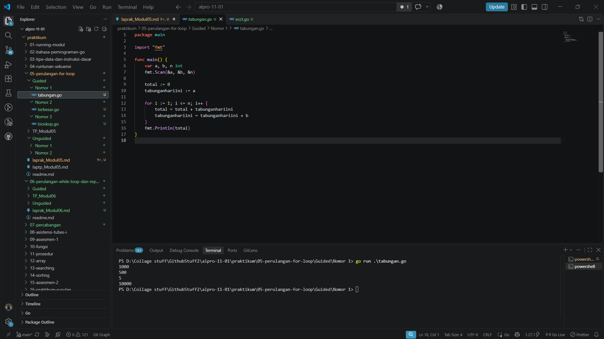
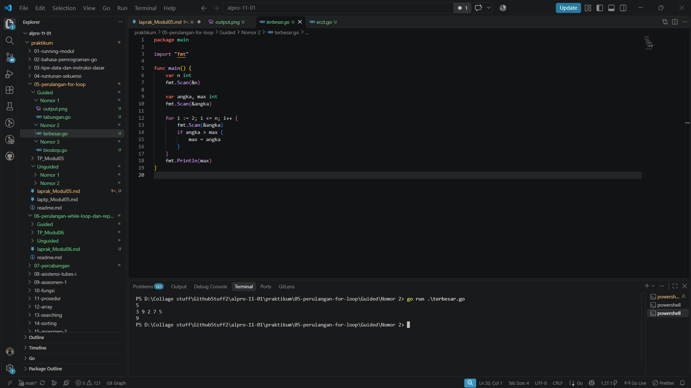
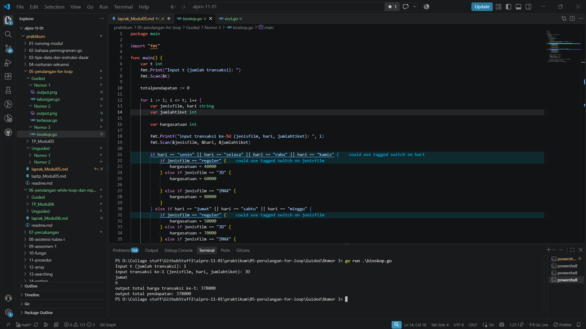
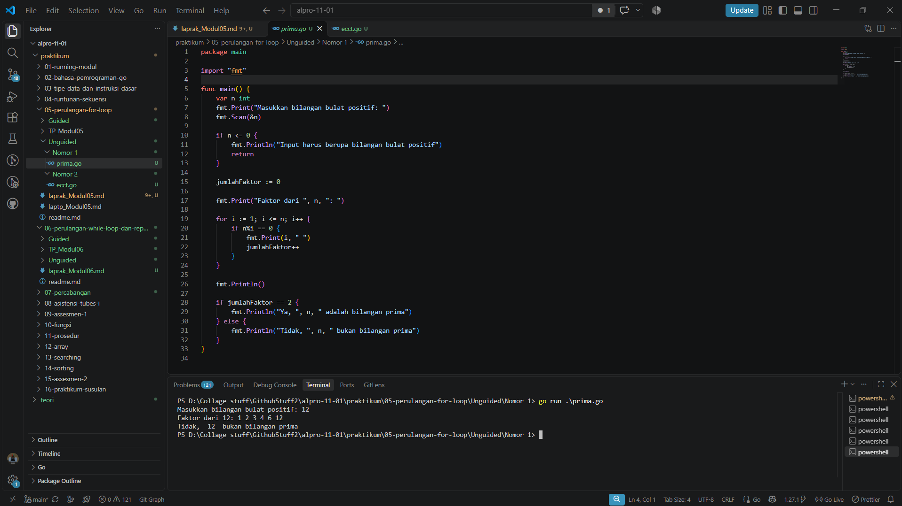
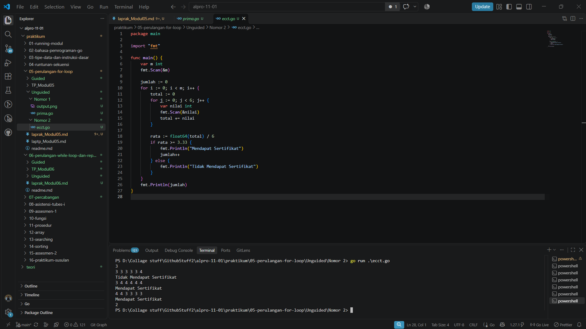

# <h1 align="center">Laporan Praktikum Modul 05 - Perulangan For</h1>
<p align="center">Deta Arief Syahputra - 109092600019</p>

## Dasar Teori

### A. Perulangan dalam Bahasa Go

Perulangan adalah struktur kontrol yang digunakan untuk menjalankan suatu blok kode secara berulang selama kondisi tertentu terpenuhi atau selama jumlah pengulangan yang ditentukan belum tercapai. Dalam bahasa Go (Golang), perulangan menggunakan kata kunci `for`. Perulangan dapat digunakan untuk memproses data berulang kali, menghitung total, mencari nilai terbesar, serta memeriksa faktor suatu bilangan.

### B. Perulangan `for` pada Go

#### 1. Bentuk Dasar Perulangan `for`

Perulangan `for` umumnya terdiri dari inisialisasi, kondisi, dan perubahan nilai penghitung. Inisialisasi dijalankan sebelum perulangan dimulai, kondisi diperiksa sebelum setiap iterasi, dan perubahan nilai penghitung dilakukan setelah isi perulangan dijalankan. Pada Go, `for` juga dapat digunakan dengan kondisi saja atau tanpa kondisi, sesuai kebutuhan program.

#### 2. Penghitung dan Akumulator

Variabel penghitung digunakan untuk mencatat jumlah iterasi yang telah dilakukan. Sementara itu, akumulator merupakan variabel yang menyimpan hasil perhitungan bertahap, misalnya untuk menjumlahkan tabungan selama beberapa hari atau menjumlahkan pendapatan dari beberapa transaksi.

#### 3. Percabangan dalam Perulangan

Struktur percabangan seperti `if`, `if-else`, dan `switch` dapat digunakan di dalam perulangan untuk menentukan tindakan berdasarkan data yang sedang diproses. Contohnya, program dapat menentukan tarif tiket berdasarkan jenis film dan hari pemutaran, memberikan diskon berdasarkan jumlah tiket, atau menentukan apakah nilai mahasiswa memenuhi syarat sertifikat.

#### 4. Mencari Nilai Terbesar dan Memeriksa Faktor

Untuk mencari bilangan terbesar, program dapat membaca bilangan satu per satu dan membandingkannya dengan nilai terbesar sementara. Untuk memeriksa faktor suatu bilangan, program dapat menguji bilangan pembagi menggunakan operator modulo (`%`). Jika sisa pembagian sama dengan nol, bilangan tersebut merupakan faktor.

## Guided

### 1. tabungan.go

**Deskripsi soal:** Budi menabung selama `n` hari. Pada hari pertama, jumlah tabungan adalah `a` rupiah dan jumlah tabungan setiap hari berikutnya bertambah `b` rupiah dari hari sebelumnya. Program menghitung total tabungan selama `n` hari menggunakan perulangan `for`, tanpa menggunakan rumus deret aritmatika.

```
package main

import "fmt"

func main() {
	var a, b, n int
	fmt.Scan(&a, &b, &n)

	total := 0
	tabunganhariini := a

	for i := 1; i <= n; i++ {
		total = total + tabunganhariini
		tabunganhariini = tabunganhariini + b
	}
	fmt.Println(total)
}
```

#### Deskripsi
Program ini dirancang untuk menerima nilai tabungan hari pertama (`a`), kenaikan tabungan setiap hari (`b`), dan jumlah hari (`n`). Perulangan digunakan untuk menghitung tabungan setiap hari dan menjumlahkannya hingga diperoleh total tabungan selama `n` hari.

 

### 2. terbesar.go

**Deskripsi soal:** Program mencari bilangan terbesar dari `n` bilangan bulat yang dimasukkan pengguna. Bilangan yang dimasukkan dapat bernilai negatif.

```
package main

import "fmt"

func main() {
	var n int
	fmt.Scan(&n)

	var angka, max int
	fmt.Scan(&angka)

	for i := 2; i <= n; i++ {
		fmt.Scan(&angka)
		if angka > max {
			max = angka
		}
	}
	fmt.Println(max)
}
```

#### Deskripsi
Program ini menerima jumlah bilangan yang akan diperiksa, kemudian membaca bilangan-bilangan tersebut menggunakan perulangan `for`. Setiap bilangan dibandingkan dengan nilai terbesar sementara agar program dapat menentukan bilangan terbesar dari seluruh masukan.



### 3. bioskop.go

**Deskripsi soal:** Program menghitung harga setiap transaksi pembelian tiket bioskop berdasarkan jenis film, hari pemutaran, dan jumlah tiket. Jenis film terdiri dari Reguler, 3D, dan IMAX. Harga tiket pada Senin–Kamis berbeda dari Jumat–Minggu. Pembelian minimal 5 tiket dalam satu transaksi mendapatkan diskon 10%. Program juga menghitung total pendapatan seluruh transaksi.


```
package main

import "fmt"

func main() {
	var t int
	fmt.Print("Input t (jumlah transaksi): ")
	fmt.Scan(&t)

	totalpendapatan := 0

	for i := 1; i <= t; i++ {
		var jenisfilm, hari string
		var jumlahtiket int

		var hargasatuan int

		fmt.Printf("input transaksi ke-%d (jenisfilm, hari, jumlahtiket): ", i)
		fmt.Scan(&jenisfilm, &hari, &jumlahtiket)

		if hari == "senin" || hari == "selasa" || hari == "rabu" || hari == "kamis" {
			if jenisfilm == "reguler" {
				hargasatuan = 40000
			} else if jenisfilm == "3D" {
				hargasatuan = 60000

			} else if jenisfilm == "IMAX" {
				hargasatuan = 80000
			}
		} else if hari == "jumat" || hari == "sabtu" || hari == "minggu" {
			if jenisfilm == "reguler" {
				hargasatuan = 50000
			} else if jenisfilm == "3D" {
				hargasatuan = 70000
			} else if jenisfilm == "IMAX" {
				hargasatuan = 90000
			}
		}

		totalharga := hargasatuan * jumlahtiket

		if jumlahtiket >= 5 {
			diskon := (totalharga * 10) / 100
			totalharga = totalharga - diskon
		}

		fmt.Printf("output total harga transaksi ke-%d: %d\n", i, totalharga)

		totalpendapatan = totalpendapatan + totalharga
	}
	fmt.Printf("output total pendapatan: %d\n", totalpendapatan)
}
```

#### Deskripsi
Program ini membaca jumlah transaksi, lalu memproses jenis film, hari pemutaran, dan jumlah tiket pada setiap transaksi. Percabangan digunakan untuk menentukan harga tiket dan menerapkan diskon jika jumlah tiket minimal 5. Perulangan digunakan untuk memproses semua transaksi dan menghitung total pendapatan.



## Unguided

### 1. prima.go

**Deskripsi soal:** Program menampilkan seluruh faktor dari sebuah bilangan bulat positif `n`, kemudian menentukan apakah bilangan tersebut merupakan bilangan prima. Bilangan prima memiliki tepat dua faktor, yaitu 1 dan bilangan itu sendiri.

```
package main

import "fmt"

func main() {
	var n int
	fmt.Print("Masukkan bilangan bulat positif: ")
	fmt.Scan(&n)

	if n <= 0 {
		fmt.Println("Input harus berupa bilangan bulat positif")
		return
	}

	jumlahFaktor := 0

	fmt.Print("Faktor dari ", n, ": ")

	for i := 1; i <= n; i++ {
		if n%i == 0 {
			fmt.Print(i, " ")
			jumlahFaktor++
		}
	}

	fmt.Println()

	if jumlahFaktor == 2 {
		fmt.Println("Ya, ", n, " adalah bilangan prima")
	} else {
		fmt.Println("Tidak, ", n, " bukan bilangan prima")
	}
}
```

##### Output



#### Deskripsi
Program ini menerima sebuah bilangan bulat positif. Perulangan digunakan untuk memeriksa bilangan-bilangan yang dapat membagi `n` tanpa sisa dan menampilkan faktor-faktornya. Jumlah faktor kemudian digunakan untuk menentukan apakah bilangan tersebut prima.

### 2. ecct.go

**Deskripsi soal:** Program menentukan apakah setiap mahasiswa baru Tel-U mendapat sertifikat ECCT berdasarkan rata-rata enam nilai, yaitu P, V, GA, FS, CI, dan TC. Mahasiswa mendapat sertifikat jika rata-rata nilainya minimal 3,33. Program juga menghitung jumlah mahasiswa yang mendapat sertifikat.

```
package main

import "fmt"

func main() {
	var m int
	fmt.Scan(&m)

	jumlah := 0
	for i := 0; i < m; i++ {
		total := 0
		for j := 0; j < 6; j++ {
			var nilai int
			fmt.Scan(&nilai)
			total += nilai
		}

		rata := float64(total) / 6
		if rata >= 3.33 {
			fmt.Println("Mendapat Sertifikat")
			jumlah++
		} else {
			fmt.Println("Tidak Mendapat Sertifikat")
		}
	}
	fmt.Println(jumlah)
}
```

##### Output



#### Deskripsi
Program ini membaca jumlah mahasiswa dan enam nilai untuk setiap mahasiswa. Nilai-nilai tersebut dijumlahkan lalu dibagi enam untuk memperoleh rata-rata. Program menentukan status sertifikat berdasarkan batas rata-rata minimal 3,33 dan menghitung jumlah mahasiswa yang mendapat sertifikat.

## Kesimpulan

Perulangan `for` pada Go dapat digunakan untuk memproses data secara berulang, menghitung akumulasi, membandingkan nilai, memeriksa faktor bilangan, dan mengolah sejumlah transaksi atau data mahasiswa. Dengan menggabungkan perulangan dan percabangan, program dapat menjalankan perhitungan serta menentukan keluaran sesuai kondisi yang ditetapkan.

## Referensi

1. The Go Authors. *A Tour of Go: For*. https://go.dev/tour/flowcontrol/1
2. The Go Authors. *The Go Programming Language Specification: For statements*. https://go.dev/ref/spec#For_statements
3. Google