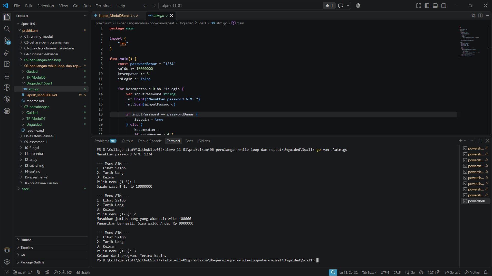

# <h1 align="center">Laporan Praktikum Modul 06 - Perulangan While</h1>
<p align="center">[Deta Arief Syahputra] - [109092600019]</p>

## Dasar Teori

### A. Perulangan dalam Pemrograman
Perulangan merupakan struktur kendali yang digunakan untuk menjalankan suatu blok perintah secara berulang selama kondisi tertentu terpenuhi. Perulangan membantu program melakukan pekerjaan yang sama tanpa harus menuliskan perintah tersebut berkali-kali. Perulangan dapat digunakan, misalnya, untuk mencari nilai yang memenuhi suatu syarat, memeriksa setiap karakter dalam teks, serta menampilkan menu program secara berulang.

### B. Perulangan While pada Bahasa Go

#### 1. Pengertian Perulangan While
Perulangan *while* menjalankan blok perintah selama kondisi yang diperiksa bernilai benar (*true*). Sebelum setiap pengulangan dilakukan, program memeriksa kondisi. Jika kondisi bernilai *false*, perulangan akan berhenti. Dengan demikian, jumlah pengulangan tidak harus diketahui sejak awal karena bergantung pada perubahan kondisi selama program berjalan.

#### 2. Bentuk Perulangan While pada Go
Bahasa Go tidak menyediakan kata kunci `while` maupun `do-while`. Perulangan dengan perilaku *while* ditulis menggunakan `for` yang hanya berisi kondisi.

Selama `kondisi` bernilai `true`, seluruh perintah di dalam blok akan dijalankan. Agar perulangan dapat berhenti, nilai yang digunakan dalam kondisi perlu diperbarui sehingga pada suatu saat kondisi menjadi `false`. Jika kondisi tidak pernah menjadi `false`, perulangan dapat berlangsung terus-menerus.

#### 3. Variabel Pengendali dan Kondisi Perulangan
Variabel pengendali digunakan untuk menentukan perkembangan proses perulangan. Variabel tersebut biasanya diberi nilai awal sebelum perulangan, diperiksa melalui kondisi, lalu diubah di dalam blok perulangan. Sebagai contoh, pencarian bilangan dapat dimulai dari nilai tertentu dan terus menaikkan nilai tersebut sampai syarat yang ditentukan terpenuhi.

#### 4. Penggunaan Indeks untuk Memeriksa String
String dapat diperiksa karakter demi karakter dengan menggunakan indeks. Fungsi `len()` dapat digunakan untuk memperoleh panjang string, sedangkan indeks digunakan untuk mengakses posisi karakter. Perulangan dapat dimulai dari indeks pertama dan dilanjutkan sampai seluruh karakter telah diperiksa. Pada soal penghitungan huruf vokal, setiap karakter diperiksa untuk menentukan apakah termasuk huruf `a`, `i`, `u`, `e`, atau `o`, baik dalam bentuk kecil maupun kapital.

#### 5. Penerapan Perulangan pada Menu dan Validasi Input
Perulangan *while* juga dapat digunakan untuk proses yang membutuhkan beberapa kali input. Pada proses login, perulangan dapat dijalankan selama password belum benar dan kesempatan masih tersedia. Pada program menu, perulangan dapat mempertahankan tampilan menu sampai pengguna memilih pilihan untuk keluar. Nilai variabel seperti jumlah percobaan, saldo, dan pilihan menu diperbarui sesuai masukan pengguna.

## Guided

### 1. terkecil.go

```
package main

import "fmt"

func main() {
	var batas int
	fmt.Scan(&batas)

	n := 1
	for n*n*n <= batas {
		n++
	}

	fmt.Println(n)

```

#### Deskripsi
Pada praktikum terbimbing pertama, dibuat program untuk mencari bilangan bulat terkecil `n` yang memenuhi kondisi `n³ > 12000`. Program memulai pencarian dari `n = 1`, kemudian memeriksa hasil pangkat tiga dari nilai tersebut menggunakan perulangan *while* yang ditulis dengan `for` berkondisi. Nilai `n` terus bertambah selama hasil pangkat tiganya belum lebih besar dari batas. Berdasarkan contoh pada modul, hasil yang diperoleh adalah `n = 23`, karena `23³ = 12167` sudah lebih besar dari 12000, sedangkan `22³ = 10648` masih lebih kecil.

### 2. terbesar.go

```
package main

import "fmt"

func main() {
	var batas int
	fmt.Scan(&batas)

	n := 1
	for n*n < batas {
		n++
	}

	fmt.Println(n - 1)
}
```

#### Deskripsi
Pada praktikum terbimbing kedua, dibuat program untuk menentukan bilangan bulat terbesar `n` yang memenuhi kondisi `n²` lebih kecil dari batas yang dimasukkan pengguna. Program memulai nilai `n` dari 1 dan menaikkannya selama kondisi `n*n < batas` masih terpenuhi. Ketika kondisi tidak lagi terpenuhi, nilai yang memenuhi syarat adalah satu angka sebelum nilai penghenti perulangan. Berdasarkan contoh modul, untuk batas 12000 diperoleh `n = 109`, sedangkan untuk batas 100000 diperoleh `n = 316`.

### 3. vokal.go

```
package main

import (
	"bufio"
	"fmt"
	"os"
	"strings"
)

func main() {
	reader := bufio.NewReader(os.Stdin)
	kalimat, _ := reader.ReadString('\n')

	i := 0
	jumlahVokal := 0

	for i < len(kalimat) {
		ch := strings.ToLower(string(kalimat[i]))
		if ch == "a" || ch == "i" || ch == "u" || ch == "e" || ch == "o" {
			jumlahVokal++
		}
		i++
	}

	fmt.Println(jumlahVokal)
}
```

#### Deskripsi
Pada praktikum terbimbing ketiga, dibuat program untuk menghitung jumlah huruf vokal dalam sebuah kata atau kalimat yang dimasukkan pengguna. Program membaca masukan satu baris, kemudian menggunakan indeks dan perulangan *while* untuk memeriksa setiap karakter hingga seluruh isi string selesai diperiksa. Setiap karakter dibandingkan dengan huruf vokal `a`, `i`, `u`, `e`, dan `o`, termasuk bentuk kapitalnya. Berdasarkan contoh pada modul, kalimat “Hello World” menghasilkan 3 huruf vokal, sedangkan “Belajar Golang” menghasilkan 5 huruf vokal.

## Unguided

### 1. atm.go

```
package main

import (
	"fmt"
)

func main() {
	const passwordBenar = "1234"
	saldo := 10000000
	kesempatan := 3
	isLogin := false

	for kesempatan > 0 && !isLogin {
		var inputPassword string
		fmt.Print("Masukkan password ATM: ")
		fmt.Scan(&inputPassword)

		if inputPassword == passwordBenar {
			isLogin = true
		} else {
			kesempatan--
			if kesempatan > 0 {
				fmt.Printf("Password salah. Sisa kesempatan: %d\n", kesempatan)
			}
		}
	}

	if !isLogin {
		fmt.Println("ATM terblokir dan program berakhir.")
		return
	}

	pilihan := 0
	for pilihan != 3 {
		fmt.Println("\n--- Menu ATM ---")
		fmt.Println("1. Lihat Saldo")
		fmt.Println("2. Tarik Uang")
		fmt.Println("3. Keluar")
		fmt.Print("Pilih menu (1-3): ")
		fmt.Scan(&pilihan)

		switch pilihan {
		case 1:
			fmt.Printf("Saldo saat ini: Rp %d\n", saldo)
		case 2:
			var jumlahTarik int
			fmt.Print("Masukkan jumlah uang yang akan ditarik: ")
			fmt.Scan(&jumlahTarik)

			if jumlahTarik <= saldo {
				saldo -= jumlahTarik
				fmt.Printf("Penarikan berhasil. Sisa saldo Anda: Rp %d\n", saldo)
			} else {
				fmt.Println("Saldo tidak mencukupi.")
			}
		case 3:
			fmt.Println("Keluar dari program. Terima kasih.")
		default:
			fmt.Println("Pilihan menu tidak valid.")
		}
	}
}
```

##### Output


#### Deskripsi
Pada praktikum mandiri, dibuat program simulasi sistem ATM dengan proses login dan menu transaksi. Pengguna diberikan maksimal tiga kesempatan untuk memasukkan password yang benar, yaitu `1234`. Jika password benar, program menampilkan menu yang menyediakan pilihan untuk melihat saldo, menarik uang, atau keluar dari program. Saldo awal yang digunakan adalah Rp10.000.000. Ketika pengguna memilih tarik uang, program meminta jumlah uang yang ingin ditarik dan mengurangi saldo apabila saldo mencukupi. Jika saldo tidak mencukupi, program menampilkan pemberitahuan. Menu akan terus ditampilkan sampai pengguna memilih keluar. Apabila password salah sebanyak tiga kali, program menampilkan pesan bahwa ATM terblokir dan program berakhir.

## Kesimpulan
Berdasarkan praktikum Modul 06, perulangan *while* pada bahasa Go dapat diterapkan menggunakan perintah `for` yang hanya berisi kondisi. Perulangan ini memungkinkan program menjalankan instruksi berulang kali selama kondisi masih bernilai benar. Penerapannya dapat digunakan untuk pencarian bilangan berdasarkan batas tertentu, pemeriksaan karakter pada string, validasi password dengan jumlah percobaan terbatas, serta pengulangan menu ATM. Praktikum ini menunjukkan pentingnya penggunaan kondisi, variabel pengendali, dan pembaruan nilai agar proses perulangan berjalan sesuai kebutuhan dan dapat berhenti pada saat yang tepat.

## Referensi
1. The Go Authors. (n.d.). *The Go Programming Language Specification: For statements*. Diakses pada 4 November 2026 melalui https://go.dev/ref/spec#For_statements
